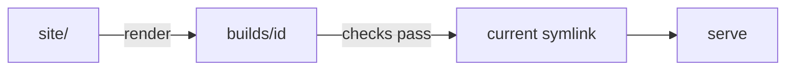

# Git Conventions

Commit-message conventions have no enforcement hook (yet) — they are held by
review, and this document is the source of truth. (Code quality IS enforced:
CI runs `cargo fmt --check`, `clippy -D warnings`, and the test suite on every
pull request; see AGENTS.md.)

## Commit Types — Use the Correct Type

Commit messages follow [Conventional Commits](https://www.conventionalcommits.org/):
`type(scope): concise description`.

Because this repo squash-merges, the message that actually lands on `main`
is the **PR title** — so these rules matter most there. Apply them to branch
commits too; it costs nothing and keeps the PR title honest.

Reserve `fix` **exclusively** for real bug fixes — something was broken **on
`main`**, now it works. This applies above all to the **PR title** (the
squash subject is what a changelog is generated from); misusing `fix` there
pollutes it.

### `fix` in feature branches

If you created the code **and** the bug in the same feature branch, it's not a
`fix`. You're refactoring your own unshipped work:

```
# ❌ WRONG — the watch loop was created in this branch, not shipped yet
fix(serve): bound the settle loop against continuously-changing files

# ✅ CORRECT — refactoring new code before it ships
refactor(serve): bound the settle loop against continuously-changing files
```

**Rule of thumb:** if the bug doesn't exist on `main`, it's not a `fix`.

### Type reference

| Type       | Use for                                      |
| ---------- | -------------------------------------------- |
| `feat`     | New user-facing capability                   |
| `fix`      | Bug fix (something was broken, now it works) |
| `test`     | Adding or updating tests                     |
| `ci`       | CI/CD pipeline changes                       |
| `chore`    | Dependency updates, tooling, configs — dep bumps are always `chore(deps)` |
| `docs`     | Documentation only                           |
| `style`    | Formatting, whitespace (no logic change)     |
| `refactor` | Code restructuring (no behaviour change)     |
| `perf`     | Performance improvement                      |
| `build`    | Build system config (Cargo profile, packaging) — NOT dep bumps |
| `revert`   | Reverting a previous commit                  |

### Scope

The scope is **mandatory**. Common scopes are the areas of the codebase:
`serve`, `routes`, `check`, `build`, `diff`, `events`, `mcp`, `i18n`,
`templates`, `deps`. The list is **open** — when none fits, use the file or
topic the change touches: `ci(ci.yml)`, `docs(git)`, `chore(gitignore)`.
Never omit it, never leave it empty.

## PR Title Format

The PR title becomes the squash commit subject on `main` — the repo's
squash settings are configured to `PR title` / `PR body` (not GitHub's
"default message", which would use the branch commit on single-commit PRs).
Format:

```
type(scope): concise description
```

GitHub automatically appends `(#PR)` on squash merge.

## PR Description (body)

Every PR body uses the **same structure**, so reviewers — human and agent —
never have to guess where information lives. A good description lets a reviewer
predict roughly what the diff looks like before opening it — and with this
repo's squash settings it **is** the squash commit body, verbatim.

### Canonical skeleton

```markdown
## Summary

1-3 sentences: the problem and why this change is the fix. Written for a
reader who has NOT seen the diff — lead with the user/system impact, not
the mechanics.

## Changes

- One bullet per meaningful change, most important first
- Name the area it touches (`serve`, `routes`, `check`, `docs`, …)
- State what is deliberately OUT of scope and why (prevents
  "why didn't you also fix X?" review rounds)

## Risk & rollback        <!-- required when the change warrants it -->

- Breaking changes to the site contract (routes.yaml schema, check-report
  shape, CLI flags), new config — each flagged on its own line, never buried
- How to revert if it goes wrong (or "revert the squash commit")
- If genuinely low-risk: "Low risk: <reason>" — one line, then move on

## Test plan

- How this was verified: commands run (`cargo fmt --check`,
  `cargo clippy --all-targets -- -D warnings`, `cargo test`), or manual
  steps a reviewer can reproduce
- Behaviour changes to serve/events: how the live loop was exercised
- If no automated tests: say so — "No automated tests; manual
  verification: <steps>"

## Review guide           <!-- optional; for larger PRs -->

- Where to start reading, in what order, and what to scrutinize
  (e.g. "start with the dedup change in render_site; the rest is mechanical")

Closes #N                 <!-- only when an issue exists; never fabricate one -->
```

### Match the depth to the change

| Change | Description depth |
| ------ | ----------------- |
| Typo, comment fix, docs-only, dep bump with no behaviour change | Summary (1 sentence) + `Closes #N` |
| Small fix/feature, 1-3 files, no architectural implications | Summary + Changes + Test plan |
| Non-trivial feature, new check layer, contract change | All sections |
| Structural / architectural change | All sections + a diagram of the new shape |

Over-writing a trivial patch wastes reviewer time; under-writing a structural
change hides intent. Both are failures.

The Risk trigger **overrides this table**: if the diff touches the site
contract (routes.yaml schema, check-report shape, CLI flags, publish
semantics), the Risk & rollback section is required no matter how small the
change is.

### Diagrams: Mermaid for topology, tables for grids

GitHub renders [Mermaid](https://mermaid.js.org/) natively in PR bodies. Use it
when the *relationships* are the point — the build/publish flow, a state
machine's transitions, before/after component topology:

````markdown

````

Use a **Markdown table** when the structure is grid-shaped (config before/after,
check × layer × trigger, option trade-offs). Use **neither** for genuine prose —
don't force structure where it doesn't aid understanding.

### For humans

- **Summary explains *why*, Changes list *what*.** Don't restate the diff in
  prose, and don't hide a behaviour change mid-list.
- For structural changes, describe **before → after** (the net end state, not
  the journey — reviewers don't need the three approaches you tried).
- **Keep it current.** If review reshapes the PR, update Summary/Changes to the
  final state before merging — the description becomes the squash commit body.

### For agents

- Pass the body via a **HEREDOC** so the markdown survives quoting:

```bash
gh pr create --title "type(scope): concise description" --body "$(cat <<'EOF'
## Summary
…

## Changes
- …

## Test plan
- …

Closes #N
EOF
)"
```

- **Never invent tests.** Every Test plan bullet must map to a command you
  actually ran, a test file present in the diff, or a manual step a human can
  reproduce. If none exist, write "No automated tests; manual verification: …".
- **Don't guess the why.** If the motivation isn't in the issue or the
  conversation, ask — or write `AUTHOR: fill in the why` rather than
  inventing a rationale.
- **Risk section is mandatory** when the diff touches the site contract
  (routes.yaml schema, check-report shape, CLI flags, publish semantics) —
  name files and behaviours, don't summarise vaguely.
- **No commit dumps.** Never paste the branch's commit list as the description.
- **Merging is the owner's call.** Open the PR, report it, and wait for the
  word — never merge on your own initiative.

## Squash Commit Body

The repo's squash settings pre-fill the commit as **PR title + PR body** —
there is nothing to hand-write at merge time. The consequences:

- **The PR description is the commit body.** Keeping it current (see above)
  is what keeps `main` history accurate.
- If you edit the message in the merge dialog anyway, never paste the
  branch's individual commit list — keep it accurate to the **final** state
  of the PR.

## PR Merge Strategy

Always use **squash + merge**. This keeps `main` history clean — one commit
per PR — and prevents transient in-progress commits from leaking into any
auto-generated changelog.

## Issue Linking

Use `Closes #N` or `Fixes #N` in the PR body to auto-close related issues on
merge. Field observations about the framework land as issues first (even small
ones) — the issue is the durable record; the PR references it. Drive-by fixes
(typos, doc polish) need no issue: **omit** `Closes #N` rather than fabricating
a reference or filing a redundant issue.
